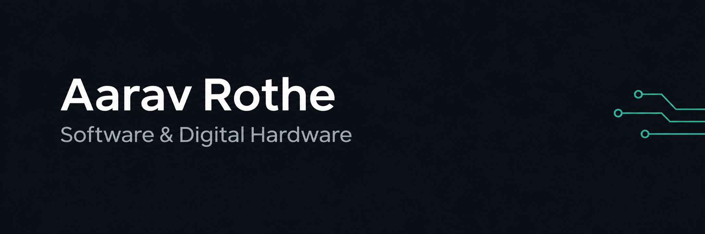

  

<h3 align="center">Finding ways to turn everyday problems into useful software! </h3>

  <a href="https://www.linkedin.com/in/aarav-rothe-82bb44269/">LinkedIn</a>
  &nbsp; / &nbsp;
  <a href="mailto:rothe.aarav@gmail.com">Email</a>
  &nbsp; / &nbsp;
  <a href="https://uwseatwatch.watch/">UWSeatWatch ↗</a>

---

### Hey, I'm Aarav 👋

I'm a **Computer Science co-op student at the University of Waterloo**.
I build backend services, full-stack applications, and tools that take
repetitive work off people's hands.

My projects include helping students find course seats, making recipes
hands-free, and replacing spreadsheet-based workflows with custom software.

🛰️ Contributing to ground-station software at **UW Orbital**  
🛠️ Previously built and deployed internal applications at **IPMD**  
🏆 **Hack the North 2024** — Best Use of Auth0  

### Things I've shipped

#### 🚀 UWSeatWatch
**Your course has a seat. Your inbox knows.**

A course-seat monitoring service used by **30+ Waterloo students**.
Checks section availability and sends email alerts, with failure handling
and safeguards against duplicate notifications.

`Python` `FastAPI` `SQLite` `Redis` `Docker`

[Try it ↗](https://uwseatwatch.watch/) ·
[Explore the code](https://github.com/Buckerit/UW_SEAT_WATCH)

 

#### 🍳 CookPilot
**Cook dinner without babysitting a recipe video.**

A voice-powered cooking assistant built in **36 hours**.
Turns recipes and YouTube videos into step-by-step instructions
using audio transcription, video processing, and structured AI outputs.

`Python` `FastAPI` `React` `OpenAI API` `FFmpeg`

[Explore the code](https://github.com/Buckerit/CookBot)

### A little outside the usual stack

🦾 **FPGA Robotic Arm Controller** — A Verilog project using state
machines to control a robotic arm on a 16 × 16 XY plane.
[Code ↗](https://github.com/Buckerit/FPGA-Robotic-Arm-Controller)

---

### My workbench

**Languages**  
Python · TypeScript/JavaScript · C · C++

**Applications & data**  
FastAPI · Express · React · PostgreSQL · SQLite · Redis

**Deployment & tooling**  
Docker · Linux · Azure · Nginx · GitHub Actions · Bash

  Build something useful. Figure out where it breaks. Make it better.

